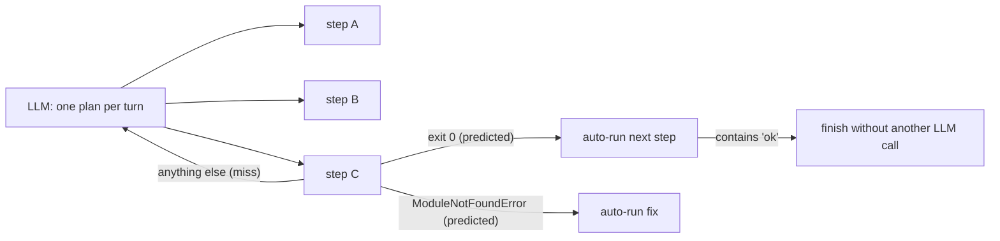

# ⚡ Blitz — the speculative, parallel AI agent

Most AI agents work like this: **model → one tool → wait → model → one tool → wait …**
Every step costs a full LLM round trip. Blitz removes those round trips in two directions:

| Direction | Idea | Effect |
|-----------|------|--------|
| **Width** | The model emits *many* tool calls per turn; the Rust runtime runs them **in parallel**. | 10 reads / searches / test suites in one turn. |
| **Depth** | For each call the model **predicts** the likely outcomes and attaches the next steps for each prediction. The runtime checks the real result and, on a hit, **runs the next steps immediately** — no LLM call. | A whole *write → run → verify → finish* chain in **one** turn. |

It's CPU branch prediction, applied to agents.



## The plan format

```json
{
  "thought": "Tests probably pass; if a module is missing, install deps and retry.",
  "steps": [
    {"id": "test", "tool": "bash", "args": {"cmd": "pytest -q"}, "predict": [
      {"when": {"exit_code": 0}, "then": [], "finish": "All tests pass."},
      {"when": {"contains": "ModuleNotFoundError"}, "then": [
        {"id": "deps", "tool": "bash", "args": {"cmd": "pip install -r requirements.txt && pytest -q"}}
      ]}
    ]},
    {"id": "status", "tool": "bash", "args": {"cmd": "git status --short"}}
  ]
}
```

**Conditions** are structured, never exact-output matches: `exit_code`, `exit_code_not`, `success`,
`contains`, `not_contains`, `regex`, `stdout_regex`, `stdout_empty`, and combinators `any` / `all` / `not`.
`{}` matches anything (an "else" branch).

**Safety rails:** a finish is only accepted if *every* prediction hit and no un-predicted step failed;
prediction trees are capped by depth (`--max-depth`, default 4) and size (`--max-nodes`, default 64);
concurrency is bounded (`--concurrency`, default 16).

**Tools:** `bash`, `read_file`, `write_file`, `edit_file`, `list_dir`, `search`.

## Providers

| Provider | Flag | API key env | Default model |
|----------|------|-------------|---------------|
| Google Gemini | `-p gemini` | `GEMINI_API_KEY` / `GOOGLE_API_KEY` | `gemini-2.5-flash` |
| OpenAI (and any OpenAI-compatible API) | `-p openai` | `OPENAI_API_KEY` (+ optional `OPENAI_BASE_URL`) | `gpt-4.1-mini` |
| Anthropic | `-p anthropic` | `ANTHROPIC_API_KEY` | `claude-sonnet-4-5` |
| Scripted mock (tests/demos) | `-p mock --mock-file f.json` | – | – |

Override the model with `-m <model>` and the endpoint with `--base-url`.

## Usage

```bash
cargo build --release

# Run the agent
export GEMINI_API_KEY=...
./target/release/blitz run -p gemini -C ./my-project "fix the failing tests and commit"

# Execute a hand-written speculative plan, no LLM involved
./target/release/blitz exec examples/demo_plan.json

# Full agent loop with a scripted model (deterministic)
./target/release/blitz run -p mock --mock-file examples/mock_session.json "explore this repo"

# Print the system prompt
./target/release/blitz prompt
```

Each run ends with stats like:

```
📊 turns: 2 | tool calls: 7 | auto-chained: 3 | predictions: 4 hit / 0 miss | parse errors: 0 | llm: 6.2s | tools: 1.1s wall vs 4.3s sequential (3.9x)
```

## Testing

```bash
cargo test
```

GitHub Actions runs fmt, clippy, tests on Linux and macOS, a release build with demos, and — if you add
`GEMINI_API_KEY`, `OPENAI_API_KEY` or `ANTHROPIC_API_KEY` as repository secrets — a live smoke test against each provider.

## Layout

```
src/condition.rs   prediction conditions
src/plan.rs        plan format + validation
src/exec.rs        parallel speculative executor
src/tools.rs       built-in tools
src/llm.rs         Gemini / OpenAI / Anthropic / mock clients
src/prompt.rs      system prompt
src/agent.rs       agent loop
src/main.rs        CLI
```

## License

MIT
